# Architecture — MouseGestureDesktop

## 执行摘要

MouseGestureDesktop 是一个 Windows 系统托盘应用，提供直观的鼠标手势控制虚拟桌面切换功能。用户按住鼠标侧键（XButton1/2）水平滑动，松开时按净位移方向切换一次虚拟桌面；滑动过程中可绘制轨迹覆盖层提供视觉反馈。

**核心特性：**
- 🎯 **单次切换语义**：无论滑动多远，松开时恰好切换一次桌面
- 🖱️ **点击保留**：未触发手势的按下-释放完整回放为单击/双击
- ⚡ **低延迟**：钩子回调 < 300ms，副作用异步投递到 UI 线程
- 🔄 **智能降级**：COM API 优先，失败后永久降级到键盘快捷键
- 🎨 **视觉反馈**：透明分层窗口渲染轨迹，支持自定义颜色和淡出
- ⚙️ **可配置**：阈值、方向、外观等 14 项参数，JSON 持久化

**技术栈：** C# · .NET 10 · Windows Forms · Win32 API (WH_MOUSE_LL, COM, SendInput)

---

## 术语表

| 术语 | 定义 |
|------|------|
| **触发按钮** | 配置的手势触发侧键（XButton1=后退，XButton2=前进） |
| **手势** | 按下触发按钮并水平滑动超过阈值的操作 |
| **Pending 状态** | 触发按钮按下但尚未确定是点击还是手势 |
| **Gesturing 状态** | 水平位移超过阈值，方向已锁定 |
| **光标冻结** | 手势期间吞下 WM_MOUSEMOVE，钉住 OS 光标 |
| **虚拟 X** | 光标冻结时累加硬件 delta 的虚拟坐标 |
| **净位移** | 手势起点到终点的水平距离（带符号） |
| **方向锁定比** | \|dx\| / \|dy\| 阈值，用于判断水平主导 |
| **取消阈值** | 回到原点此距离内 → 手势取消 → 回放单击 |
| **COM 内部 API** | IVirtualDesktopManagerInternal， undocumented Windows API |
| **FallbackSwitcher** | COM 首次失败后永久降级到键盘快捷键的包装器 |
| **分层窗口** | WS_EX_LAYERED 窗口，支持 per-pixel alpha 混合 |
| **BeginInvoke** | WinForms 异步投递消息到 UI 线程的方法 |

---

## 1. 顶层模块总览

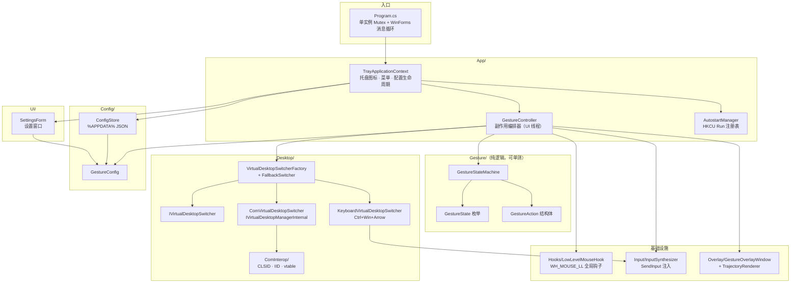

---

## 2. 数据流（一次完整手势）

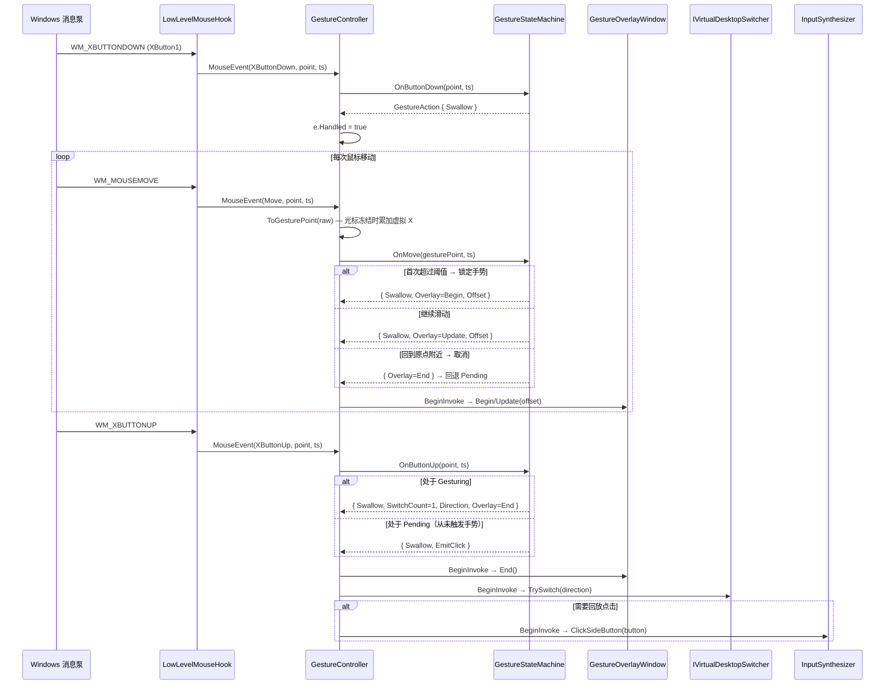

---

## 3. 手势状态机

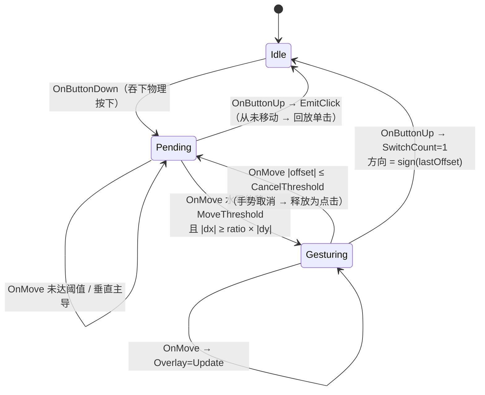

**关键不变式：**
- 切换只在 `OnButtonUp` 且状态为 `Gesturing` 时发生，且恰好一次。
- `GestureStateMachine` 不包含任何 Win32 / UI 调用——这是其可单测的前提。
- 所有副作用（切换桌面、回放点击、覆盖层绘制）由 `GestureController` 通过 `Overlay.BeginInvoke` 延迟到 UI 线程执行。

---

## 4. 虚拟桌面切换器策略

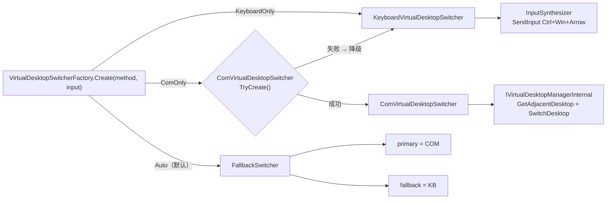

**降级策略（Auto 模式）：**
1. 优先尝试 COM 内部 API（按 Windows build 匹配 IID）。
2. 首次 `TrySwitch` 失败后，`FallbackSwitcher._degraded = true`，永久降级到键盘快捷键。
3. COM 绑定失败（build 不支持 / IID 不匹配 / 探测调用异常）→ 直接使用键盘后端。

---

## 5. 覆盖层渲染管线

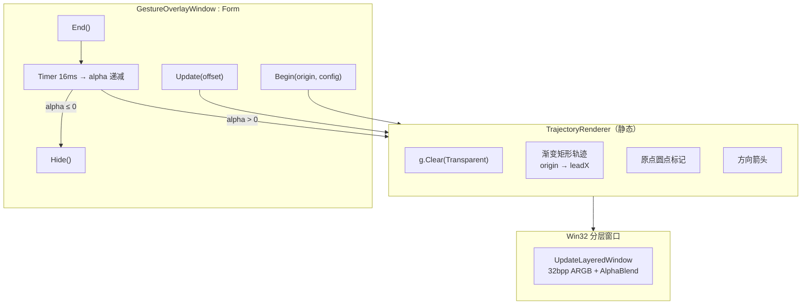

**窗口属性：** `WS_EX_LAYERED | WS_EX_TRANSPARENT | WS_EX_TOPMOST | WS_EX_TOOLWINDOW | WS_EX_NOACTIVATE` — 透明、不获焦、不拦截点击、不出现在任务栏。

**渲染区域：** 以手势原点为中心、高度 160px 的水平条带（而非全屏），降低渲染开销。

---

## 6. 光标冻结机制

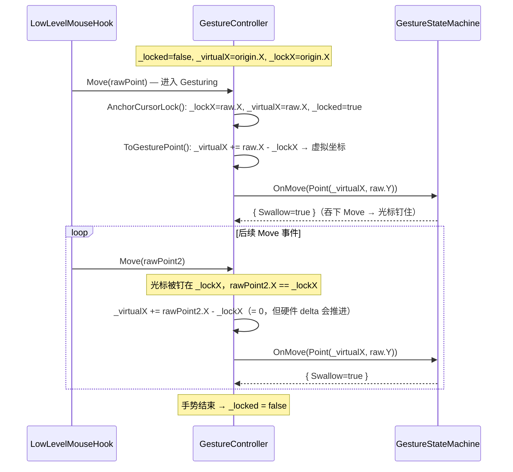

**目的：** 吞下 `WM_MOUSEMOVE` 使 OS 光标钉住，但通过 `_virtualX` 累加硬件 delta，让状态机继续感知水平位移。

---

## 7. 配置持久化

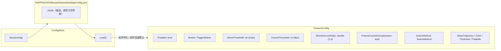

**容错：** 配置文件缺失或损坏 → `ConfigStore.Load()` 返回 `new GestureConfig()` 默认值，不崩溃。

---

## 8. 类依赖关系

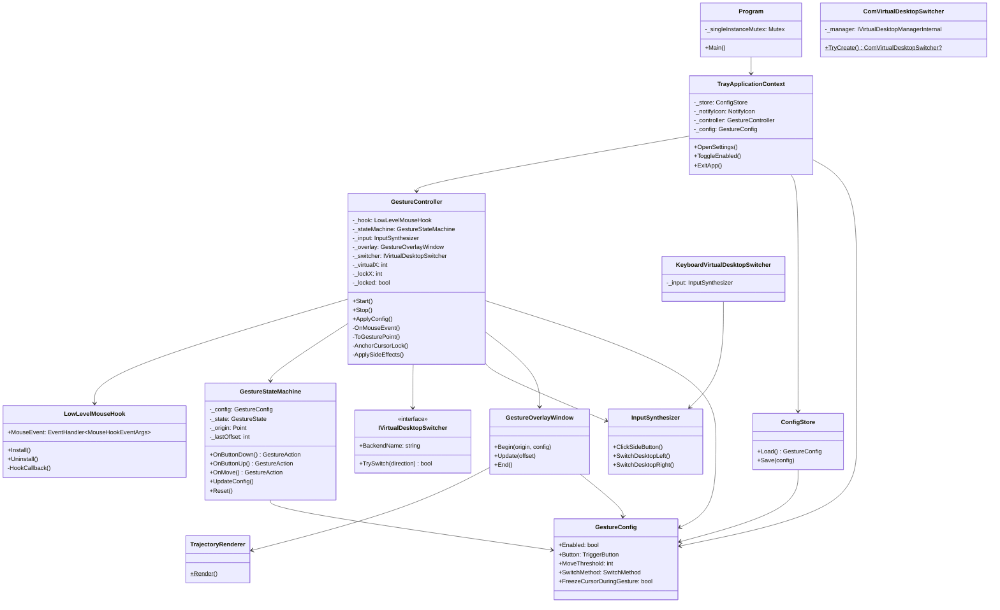

---

## 9. 项目文件结构

```
MouseGestureDesktop/
├── Program.cs                          # 入口，全局 Mutex 单实例守卫
├── App/
│   ├── TrayApplicationContext.cs       # 托盘图标、菜单、配置热更新
│   ├── GestureController.cs            # 核心编排器：钩子 → 状态机 → 副作用
│   └── AutostartManager.cs            # HKCU\...\Run 注册表管理
├── Gesture/                            # ★ 纯逻辑层，无 Win32 依赖，可单测
│   ├── GestureStateMachine.cs          # 状态机：Idle → Pending → Gesturing
│   ├── GestureState.cs                 # 状态枚举
│   └── GestureAction.cs               # 动作结构体（Swallow / EmitClick / Switch / Overlay）
├── Hooks/
│   ├── LowLevelMouseHook.cs            # WH_MOUSE_LL 全局鼠标钩子
│   └── MouseHookEventArgs.cs           # 钩子事件载荷
├── Input/
│   └── InputSynthesizer.cs             # SendInput：回放侧键点击 + Ctrl+Win+Arrow
├── Desktop/
│   ├── IVirtualDesktopSwitcher.cs      # 切换器接口
│   ├── VirtualDesktopSwitcherFactory.cs # 工厂 + FallbackSwitcher 降级包装
│   ├── ComVirtualDesktopSwitcher.cs    # COM 内部 API（build-specific IID）
│   ├── KeyboardVirtualDesktopSwitcher.cs # 键盘快捷键回退
│   └── ComInterop/
│       └── VirtualDesktopInterop.cs    # CLSID / IID / vtable 定义
├── Overlay/
│   ├── GestureOverlayWindow.cs         # 透明分层覆盖窗口
│   └── TrajectoryRenderer.cs           # 轨迹绘制（渐变尾迹 + 箭头）
├── Config/
│   ├── GestureConfig.cs                # 配置模型（阈值、行为开关、外观）
│   └── ConfigStore.cs                  # JSON 持久化（%APPDATA%）
├── UI/
│   └── SettingsForm.cs                 # 设置窗口（WinForms）
└── Resources/
	└── app.ico                         # 托盘图标

MouseGestureDesktop.Tests/
└── GestureStateMachineTests.cs         # xUnit：9 个测试覆盖状态机全部分支
```

---

## 10. 设计约束与不变式

| 约束 | 说明 |
|------|------|
| **状态机纯净** | `GestureStateMachine` 只消费坐标/时间戳、只返回 `GestureAction`，不含 Win32/UI 调用 |
| **钩子快速返回** | 副作用通过 `_overlay.BeginInvoke(...)` 延迟到 UI 线程，避免低级钩子超时被系统摘除 |
| **永不响应自身输入** | `e.Injected` 为 true 时直接 `return`，防止 `SendInput` 触发自反馈循环 |
| **单次切换** | 无论滑动多远，松开侧键时恰好切换一次桌面（方向由净位移符号决定） |
| **点击保留** | 未进入手势的按下-释放完整回放为单击/双击（`EmitClick`） |
| **配置容错** | 配置文件损坏或缺失时回退到默认值，托盘应用不崩溃 |
| **COM 安全降级** | Auto 模式下 COM 首次失败后永久降级到键盘快捷键，不再重试 COM |

---

## 11. 线程模型

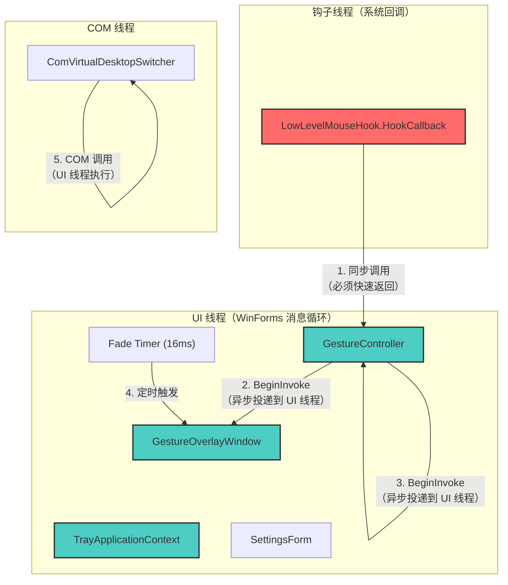

**线程安全要点：**
- `LowLevelMouseHook.HookCallback` 在系统专用线程执行，必须快速返回（< 300ms），否则系统摘除钩子。
- 所有副作用（切换桌面、回放点击、覆盖层绘制）通过 `BeginInvoke` 异步投递到 UI 线程。
- `GestureStateMachine` 在钩子线程同步调用，但因其无状态副作用，线程安全。
- COM 调用在 UI 线程执行（`ApplySideEffects` 通过 `BeginInvoke` 调度）。

---

## 12. 构建与测试工作流

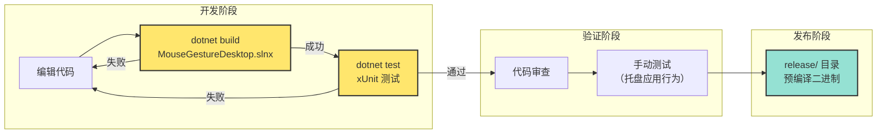

**测试覆盖：**
- `GestureStateMachineTests` 包含 9 个测试用例，覆盖状态机全部分支：
  - 快速点击 → 回放单击
  - 水平滑动 → 切换一次（左/右）
  - 反向滑动 → 方向反转
  - 大距离滑动 → 仍只切换一次
  - 回到原点 → 取消手势 → 回放单击
  - 垂直移动 → 不锁定方向
  - 对角线移动（低于阈值比） → 不锁定
  - 禁用状态 → 透传事件
  - 禁用光标冻结 → 不吞下移动事件

---

## 13. COM 互操作层详解

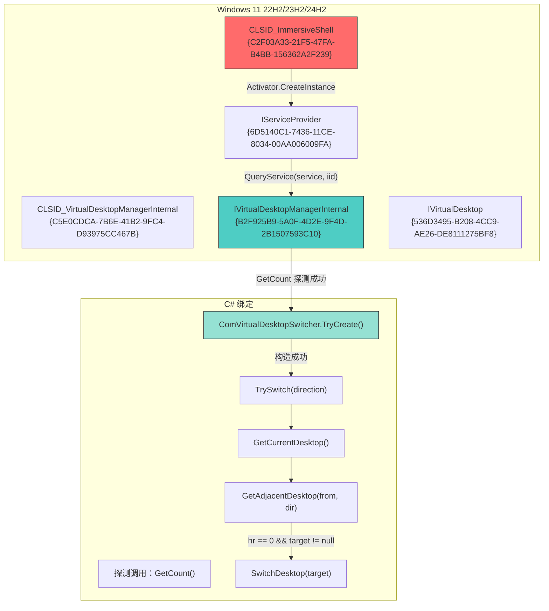

**Build-specific IID 映射：**
- Windows 11 22H2 (build 22621)、23H2 (build 22631)、24H2 (build 26100) 使用相同的 IID。
- `BuildProfiles.TryGet(build)` 查询支持的 build 号；不支持的 build → COM 绑定失败 → 降级到键盘。
- `IVirtualDesktopManagerInternal` 的 vtable 布局必须与声明一致，否则 `GetCount` 探测会失败。

---

## 14. 配置项说明

| 配置项 | 类型 | 默认值 | 说明 |
|--------|------|--------|------|
| `Enabled` | bool | `true` | 是否启用手势识别 |
| `Autostart` | bool | `false` | 开机自启（HKCU Run 注册表） |
| `Button` | TriggerButton | `XButton1` | 触发手势的侧键（XButton1=后退，XButton2=前进） |
| `MoveThreshold` | int | `12` | 进入手势模式所需的最小水平位移（像素） |
| `ClickMaxDuration` | int | `220` | 单击判定时长（毫秒），信息性参数 |
| `DirectionLockRatio` | double | `1.5` | 方向锁定比：\|dx\| ≥ ratio × \|dy\| 时锁定水平轴 |
| `CancelThreshold` | int | `8` | 取消阈值：回到原点此距离内 → 手势取消 → 回放单击 |
| `InvertDirection` | bool | `false` | 反转切换方向（物理右 → 逻辑左） |
| `FreezeCursorDuringGesture` | bool | `true` | 手势期间冻结 OS 光标（吞下 WM_MOUSEMOVE） |
| `SwitchMethod` | SwitchMethod | `Auto` | 切换方式：Auto / ComOnly / KeyboardOnly |
| `ShowTrajectory` | bool | `true` | 是否显示轨迹覆盖层 |
| `TrajectoryColorArgb` | int | `0xFF4EA1FF` | 轨迹颜色（ARGB 打包整数） |
| `TrajectoryThickness` | int | `4` | 轨迹线条粗细（像素） |
| `TrajectoryFadeMs` | int | `250` | 轨迹淡出时长（毫秒） |

---

## 15. 扩展点

| 扩展场景 | 实现方式 |
|----------|----------|
| 添加新的触发按钮 | 在 `TriggerButton` 枚举添加新值，更新 `GestureController.IsTriggerButton` |
| 支持垂直手势 | 扩展 `GestureStateMachine` 锁定垂直轴，`SwitchDirection` 添加 Up/Down |
| 多步切换（连续滑动切换多个桌面） | 修改 `GestureStateMachine.HandleGesturingMove` 在滑动过程中发射 `SwitchCount` |
| 支持新的 Windows build | 在 `BuildProfiles.Map` 添加新 build 号，验证 IID 匹配 |
| 自定义轨迹样式 | 扩展 `TrajectoryRenderer.Render` 添加新的绘制逻辑 |
| 添加新的配置项 | 在 `GestureConfig` 添加属性，更新 `SettingsForm` UI 绑定 |

---

## 16. 错误处理与恢复策略

```mermaid
graph TB
    subgraph "钩子层"
        HookError["HookCallback 异常"]
        HookCatch["catch 块：吞下异常<br/>继续调用 CallNextHookEx"]
    end

    subgraph "控制器层"
        SideEffectError["ApplySideEffects 异常"]
        SideEffectCatch["catch 块：吞下异常<br/>不崩溃托盘应用"]
    end

    subgraph "配置层"
        ConfigError["ConfigStore.Load 异常"]
        ConfigCatch["catch 块：返回默认配置"]
    end

    subgraph "COM 层"
        COMError["COM 调用失败<br/>（COMException / InvalidCastException）"]
        COMCatch["TrySwitch 返回 false<br/>FallbackSwitcher 降级"]
    end

    HookError --> HookCatch
    SideEffectError --> SideEffectCatch
    ConfigError --> ConfigCatch
    COMError --> COMCatch

    style HookCatch fill:#ff6b6b,stroke:#333
    style SideEffectCatch fill:#ff6b6b,stroke:#333
    style ConfigCatch fill:#ffe66d,stroke:#333
    style COMCatch fill:#4ecdc4,stroke:#333
```

**恢复策略：**
- **钩子异常**：`HookCallback` 的 `try-catch` 确保订阅者异常不会中断全局钩子链。
- **副作用异常**：`ApplySideEffects` 的 `try-catch` 确保桌面切换/覆盖层失败不会导致托盘应用崩溃。
- **配置损坏**：`ConfigStore.Load` 捕获所有异常，返回 `new GestureConfig()` 默认值。
- **COM 失败**：`ComVirtualDesktopSwitcher.TrySwitch` 捕获 `COMException` 和 `InvalidCastException`，返回 `false`；`FallbackSwitcher` 永久降级到键盘后端。
- **钩子安装失败**：`LowLevelMouseHook.Install` 抛出 `InvalidOperationException`，`TrayApplicationContext` 捕获并弹出消息框。

---

## 17. 性能特征

| 组件 | 性能关键点 | 优化策略 |
|------|-----------|----------|
| **LowLevelMouseHook** | 钩子回调必须 < 300ms，否则系统摘除 | 只做最小解析，副作用异步投递 |
| **GestureStateMachine** | 每次鼠标移动同步调用 | 纯计算，无分配，O(1) 复杂度 |
| **GestureOverlayWindow** | 16ms Timer 触发渲染 | 仅渲染 160px 高度条带，非全屏 |
| **TrajectoryRenderer** | 每帧创建 GraphicsPath / Brush | 使用 `using` 及时释放，避免 GC 压力 |
| **UpdateLayeredWindow** | 每帧调用 Win32 API | 32bpp ARGB 位图，硬件加速混合 |
| **ComVirtualDesktopSwitcher** | COM 调用可能阻塞 | 首次失败后永久降级，不再重试 |
| **ConfigStore** | 启动时加载，设置时保存 | JSON 序列化，文件 I/O 仅在配置变更时 |

**内存分配热点：**
- `TrajectoryRenderer.Render` 每帧创建 `GraphicsPath`、`LinearGradientBrush`、`SolidBrush` — 全部 `using` 释放。
- `GestureOverlayWindow.Render` 每帧创建 `Bitmap` 和 `Graphics` — `using` 释放。
- `GestureAction` 是 `readonly struct`，避免堆分配。

---

## 18. 调试与故障排查

### 常见问题

| 症状 | 可能原因 | 排查方法 |
|------|---------|---------|
| 手势无响应 | 钩子未安装 / 配置 `Enabled=false` | 检查托盘图标 tooltip 是否显示"已启用" |
| 切换方向相反 | `InvertDirection=true` | 设置窗口取消勾选"反转方向" |
| 覆盖层不显示 | `ShowTrajectory=false` | 设置窗口勾选"显示轨迹" |
| COM 切换失败 | Windows build 不支持 | 检查 tooltip 是否显示"Keyboard"后端 |
| 钩子被系统摘除 | 回调超时 > 300ms | 检查是否有阻塞操作在钩子线程 |
| 配置丢失 | 配置文件损坏 | 检查 `%APPDATA%\MouseGestureDesktop\config.json` |

### 日志策略

当前版本无持久化日志。调试时可：
1. 在 `GestureController.OnMouseEvent` 添加 `Console.WriteLine` 输出事件序列。
2. 在 `GestureStateMachine` 各分支添加断言或日志。
3. 使用 DebugView 等工具捕获 `Debug.WriteLine` 输出。

---

## 19. 部署与分发

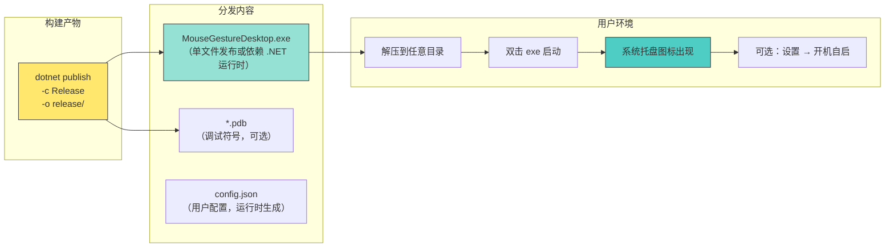

**运行要求：**
- **操作系统**：Windows 10/11（依赖 `WH_MOUSE_LL` 和虚拟桌面 API）
- **.NET 运行时**：.NET 10（若使用框架依赖发布）或自包含发布（无需安装运行时）
- **权限**：无需管理员权限（全局鼠标钩子由系统授权，注册表写入仅限 HKCU）

**单实例守卫：**
- `Program.Main` 创建全局 Mutex `"MouseGestureDesktop.SingleInstance"`。
- 第二个实例启动时检测到 Mutex 已存在，弹出消息框后退出。

---

## 20. 架构决策记录（ADR）

### ADR-001：状态机与副作用分离
**决策**：`GestureStateMachine` 只返回 `GestureAction`，不包含 Win32/UI 调用。  
**理由**：状态机可独立单测（`GestureStateMachineTests` 使用合成事件序列），不依赖 Windows 环境。  
**后果**：需要 `GestureController` 作为编排器解释 `GestureAction` 并执行副作用。

### ADR-002：切换只在释放时发生
**决策**：滑动过程中不切换桌面，只在 `OnButtonUp` 时根据净位移方向切换一次。  
**理由**：避免连续滑动触发多次切换，用户意图更明确（"滑到那边去"）。  
**后果**：大距离滑动不会加速切换，始终保持一次。

### ADR-003：COM 优先 + 键盘回退
**决策**：`Auto` 模式优先尝试 COM 内部 API，首次失败后永久降级到键盘快捷键。  
**理由**：COM API 可精确控制（不依赖键盘状态），但 build-specific IID 可能不匹配；键盘快捷键通用但无法读取当前桌面索引。  
**后果**：`FallbackSwitcher` 维护 `_degraded` 标志，避免每次切换都尝试 COM。

### ADR-004：光标冻结机制
**决策**：手势期间吞下 `WM_MOUSEMOVE`，通过 `_virtualX` 累加硬件 delta。  
**理由**：防止 OS 光标移动干扰手势轨迹，同时保持状态机感知水平位移。  
**后果**：需要额外的坐标转换逻辑（`ToGesturePoint`），增加代码复杂度。

### ADR-005：覆盖层使用分层窗口
**决策**：`GestureOverlayWindow` 使用 `WS_EX_LAYERED | WS_EX_TRANSPARENT` + `UpdateLayeredWindow`。  
**理由**：透明、不获焦、不拦截点击，视觉反馈不干扰用户操作。  
**后果**：每帧需要创建位图并调用 Win32 API，性能开销高于普通窗口绘制。

---

## 21. 快速开始指南

### 开发环境设置

```powershell
# 1. 克隆仓库
git clone <repo-url>
cd MouseGestureDesktop

# 2. 构建解决方案
dotnet build MouseGestureDesktop.slnx

# 3. 运行测试
dotnet test

# 4. 启动托盘应用
dotnet run --project MouseGestureDesktop
```

### 首次运行

1. 启动后系统托盘出现图标，tooltip 显示"已启用"。
2. 按住鼠标侧键（默认 XButton1/后退键），水平滑动。
3. 滑动超过 12px 后看到轨迹覆盖层。
4. 松开侧键，切换一次虚拟桌面。
5. 右键托盘图标 → "设置…" 调整参数。

### 常用操作

| 操作 | 说明 |
|------|------|
| 右键托盘图标 | 打开菜单（设置/启用/自启/退出） |
| 双击托盘图标 | 打开设置窗口 |
| 按住侧键 + 水平滑动 | 切换虚拟桌面 |
| 按住侧键 + 垂直滑动 | 不触发手势（透传） |
| 按住侧键 + 滑动 + 回到原点 | 取消手势 → 回放单击 |

---

## 22. API 参考

### GestureStateMachine

```csharp
public sealed class GestureStateMachine
{
    public GestureState State { get; }

    // 消费按下事件，返回是否吞下
    public GestureAction OnButtonDown(Point point, long timestamp);

    // 消费释放事件，返回切换/点击指令
    public GestureAction OnButtonUp(Point point, long timestamp);

    // 消费移动事件，返回覆盖层更新指令
    public GestureAction OnMove(Point point, long timestamp);

    // 热更新配置（下次手势生效）
    public void UpdateConfig(GestureConfig config);

    // 重置为 Idle 状态
    public void Reset();
}
```

### GestureAction

```csharp
public readonly struct GestureAction
{
    public bool Swallow { get; init; }           // 吞下事件（hook 返回 1）
    public bool EmitClick { get; init; }         // 回放单击（SendInput）
    public int SwitchCount { get; init; }        // 切换次数（0 或 1）
    public SwitchDirection SwitchDirection { get; init; } // 切换方向
    public OverlayPhase Overlay { get; init; }   // 覆盖层阶段
    public int OverlayOffset { get; init; }      // 覆盖层偏移（px）

    public static GestureAction PassThrough { get; } // 透传事件
    public static GestureAction Swallowed { get; }   // 吞下事件
}
```

### IVirtualDesktopSwitcher

```csharp
public interface IVirtualDesktopSwitcher
{
    string BackendName { get; }  // 后端名称（tooltip 显示）
    bool TrySwitch(SwitchDirection direction);  // 切换桌面，失败返回 false
}
```

### GestureController

```csharp
public sealed class GestureController : IDisposable
{
    public string BackendName { get; }  // 当前切换器后端名称

    public void Start();                // 安装钩子
    public void Stop();                 // 卸载钩子
    public void ApplyConfig(GestureConfig config);  // 热更新配置
    public void Dispose();              // 释放资源
}
```

---

## 23. 常见问题（FAQ）

**Q: 为什么我的 Windows build 不支持 COM 切换？**  
A: COM 内部 API 的 IID 是 build-specific 的。当前支持 Windows 11 22H2/23H2/24H2（build 22621/22631/26100）。其他 build 会自动降级到键盘快捷键。

**Q: 手势不灵敏怎么办？**  
A: 调整 `MoveThreshold`（降低阈值使手势更容易触发）和 `DirectionLockRatio`（降低比值使方向锁定更宽松）。

**Q: 如何禁用轨迹覆盖层？**  
A: 设置窗口取消勾选"显示轨迹"，或配置 `ShowTrajectory = false`。

**Q: 可以同时支持多个触发按钮吗？**  
A: 当前版本只支持单个触发按钮（XButton1 或 XButton2）。需要多按钮支持需扩展代码。

**Q: 为什么手势期间光标不动？**  
A: 这是"光标冻结"特性（`FreezeCursorDuringGesture = true`），防止 OS 光标移动干扰手势。可在设置中关闭。

**Q: 配置文件的格式是什么？**  
A: JSON 格式，枚举值为字符串（如 `"Button": "XButton1"`）。路径：`%APPDATA%\MouseGestureDesktop\config.json`。

**Q: 如何完全卸载？**  
A: 右键托盘图标 → "退出"，删除 exe 文件和 `%APPDATA%\MouseGestureDesktop` 目录。如启用了自启，删除注册表项 `HKCU\Software\Microsoft\Windows\CurrentVersion\Run\MouseGestureDesktop`。

---

## 24. 相关链接

- **源代码仓库**：`D:\repos\MouseGestureDesktop\`
- **解决方案文件**：`MouseGestureDesktop.slnx`
- **测试项目**：`MouseGestureDesktop.Tests\`
- **发布目录**：`release\`
- **配置文件位置**：`%APPDATA%\MouseGestureDesktop\config.json`
- **AGENTS.md**：编码代理指引（项目根目录）
